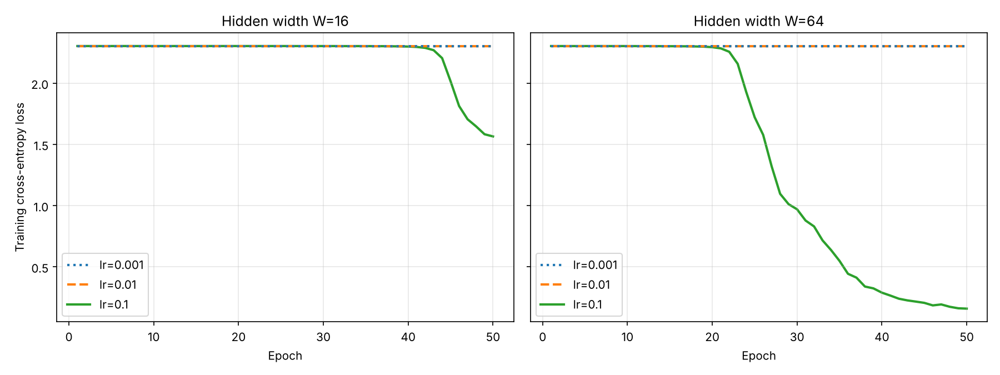

# Lab 2: A neural network from scratch

## 1. Goal

Build a two-hidden-layer MLP in pure NumPy, implement forward pass, cross-entropy and backpropagation by hand, verify gradients numerically, and compare learning rates, hidden widths and forward/backward timing on `load_digits`.

## 2. Method

**Data.** `load_digits` (1797 images 8×8 → 64 features), pixels divided by 16 to [0, 1], labels one-hot encoded, 70/30 stratified split with `random_state=42` (train 1257, test 540).

**Network design.**

```
x (B,64) → z1 = x·W1 + b1 → a1 = ReLU(z1) (B,W)
         → z2 = a1·W2 + b2 → a2 = ReLU(z2) (B,W)
         → z3 = a2·W3 + b3 → p = softmax(z3) (B,10)
```

| Param | Shape | W=16 | W=64 |
|---|---|---|---|
| W1, b1 | (64,W), (W,) | 1 024 + 16 | 4 096 + 64 |
| W2, b2 | (W,W), (W,) | 256 + 16 | 4 096 + 64 |
| W3, b3 | (W,10), (10,) | 160 + 10 | 640 + 10 |
| **Total** | | **1 482** | **8 970** |

Weights from N(0, 0.01) (std = 0.01), biases zero.

**Loss.** L = −(1/B) Σ Σ y·log p. Softmax subtracts the row max for numerical stability; log uses clipping to avoid log(0).

**Gradients (chain rule).**

```
dz3 = (p − y) / B                  (softmax + cross-entropy combined)
dW3 = a2ᵀ·dz3      db3 = Σ dz3
da2 = dz3·W3ᵀ      dz2 = da2 ⊙ [z2 > 0]
dW2 = a1ᵀ·dz2      db2 = Σ dz2
da1 = dz2·W2ᵀ      dz1 = da1 ⊙ [z1 > 0]
dW1 = xᵀ·dz1       db1 = Σ dz1
```

**Gradient check.** Batch of 32, 10 random weights across W1/W2/W3 (only weights with non-zero gradient, since zero ones pass trivially), central difference with ε = 1e-5, relative error |a − n| / (|a| + |n|).

**Training.** Mini-batch SGD, batch 32, shuffled every epoch, 50 epochs, lr ∈ {0.001, 0.01, 0.1}, W ∈ {16, 64}, seed 42.

**Timing.** Batch of 32, 1 warm-up, median of 100 runs, forward and backward timed separately with `time.perf_counter`.

## 3. Results

**Sanity checks**

| Check | Result |
|---|---|
| Output shape | (1257, 10) ✓ |
| Max \|row sum − 1\| | 4.44e-16 (< 1e-6) ✓ |
| Untrained loss | 2.3026 (ln 10 = 2.3026) ✓ |

**Gradient check** (`results/grad_check_main.csv`, init std = 0.1): **10/10 passed**, max relative error 3.6e-8.

| Param | Index | Analytic | Numerical | Rel. error |
|---|---|---|---|---|
| W1 | (5, 9) | 0.001467 | 0.001467 | 6.8e-9 |
| W2 | (13, 5) | −0.000247 | −0.000247 | 2.0e-8 |
| W3 | (11, 1) | 0.000233 | 0.000233 | 3.6e-8 |
| W1 | (28, 4) | 0.009631 | 0.009631 | 2.0e-10 |
| W2 | (5, 15) | 0.000388 | 0.000388 | 6.3e-9 |
| W3 | (14, 0) | 0.001578 | 0.001578 | 7.5e-9 |
| W1 | (5, 5) | 0.000244 | 0.000244 | 5.6e-9 |
| W2 | (11, 5) | 0.003359 | 0.003359 | 3.0e-9 |
| W3 | (4, 8) | −0.000342 | −0.000342 | 1.9e-8 |
| W1 | (5, 11) | −0.003497 | −0.003497 | 1.9e-9 |

At the training init (std = 0.01, `results/grad_check_std001.csv`) only 4/10 pass. With such small weights the gradients are ~1e-6 and the loss is ~2.3, so the finite difference (L₊ − L₋) loses most significant digits to float64 round-off, and ±ε can push tiny pre-activations across the ReLU kink. The backward code is identical in both cases, so the std = 0.1 check is the valid test of the derivation.

**Training** (`results/accuracy.csv`, `results/loss_curves.png`)

| W | lr | Final train loss | Test accuracy |
|---|---|---|---|
| 16 | 0.001 | 2.3026 | 0.1019 |
| 16 | 0.01 | 2.3026 | 0.1019 |
| 16 | 0.1 | 1.5656 | 0.3259 |
| 64 | 0.001 | 2.3025 | 0.1019 |
| 64 | 0.01 | 2.3025 | 0.1019 |
| 64 | 0.1 | 0.1594 | **0.9389** |



**Timing** (`results/timing.csv`, batch 32)

| W | Forward (µs) | Backward (µs) | Backward / Forward |
|---|---|---|---|
| 16 | 12.9 | 13.4 | 1.04 |
| 64 | 17.5 | 22.2 | 1.27 |

## 4. Conclusions

1. My backpropagation is correct. With init std = 0.1 all 10 checked weights matched the numerical gradient. With the required init N(0, 0.01) only 4 of 10 passed, but this is not a bug in the code. The gradients there are very small (about 1e-6), so the numerical estimate is ruined by floating point rounding. The same backward code passes when the weights are bigger.

2. The small initialisation makes training very slow at the start. The output is almost uniform, so the loss stays at ln(10) = 2.30 and the gradients are tiny. With lr 0.001 and 0.01 the network did not learn anything in 50 epochs. Only lr 0.1 got out of this flat part. W = 64 started learning around epoch 20 and reached 93.9% test accuracy, while W = 16 only started around epoch 42 and got 32.6%. A wider layer has bigger activations and gradients, so it escapes faster. A better initialisation would probably fix this.

3. The backward pass is slower than the forward pass. Forward does 3 matrix multiplications and backward does 5, so in theory backward should take about 2x longer. I measured only 1.04x for W = 16 and 1.27x for W = 64. With a batch of 32 the matrices are very small, so most of the time is overhead from calling NumPy functions, not the math itself. When W gets bigger the matrix multiplications take more of the time and the ratio grows.