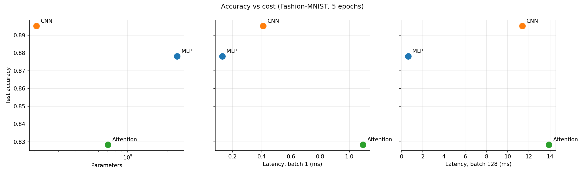

# Lab 3: Architectures and their costs

## 1. Goal

Build three models of different architecture (MLP, CNN, attention) for Fashion-MNIST, calculate their parameters and FLOPs by hand and compare with tools, measure inference latency, train them and decide which one is the most cost-effective.

## 2. Method

**Data.** Fashion-MNIST, `ToTensor()` + `Normalize((0.2860,), (0.3530,))`. Official 60k train split into 55k train and 5k validation (`random_split`, seed 42), official 10k test. Batch size 128.

**Models.**
- MLP: Flatten 784 → Linear 256 → ReLU → Linear 128 → ReLU → Linear 10.
- CNN: Conv2d(1,16,3,p=1) → ReLU → MaxPool2 → Conv2d(16,32,3,p=1) → ReLU → MaxPool2 → Flatten → Linear(1568,10).
- Attention: 16 patches of 7×7 (49 pixels) → Linear 49→64 → 2× TransformerEncoderLayer (d_model 64, 4 heads, FFN 128) → mean pool over patches → Linear 64→10. No positional embedding, because the manual does not include one.

**Cost.** Parameters with `torchinfo.summary`. FLOPs by hand with Ch. 4 formulas (Linear 2·in·out, Conv 2·K²·C_in·C_out·H_out·W_out, attention as below) and with `thop.profile` (thop returns MACs, so I multiply by 2). Latency on CPU with `torch.no_grad()`, 5 warm-up runs, median of 100 runs for batch 1 and 20 runs for batch 128.

**Training.** Adam, lr 1e-3, batch 128, 5 epochs, seed 42, test accuracy after the last epoch.

## 3. Results

### Parameters (by hand, checked with torchinfo)

| Model | Layers | Params |
|---|---|---|
| MLP | 784·256+256 = 200 960; 256·128+128 = 32 896; 128·10+10 = 1 290 | **235 146** |
| CNN | 1·16·9+16 = 160; 16·32·9+32 = 4 640; 1568·10+10 = 15 690 | **20 490** |
| Attention | patch proj 49·64+64 = 3 200; 2 × encoder 33 472 = 66 944; head 64·10+10 = 650 | **70 794** |

One encoder layer: QKV 64·192+192 = 12 480, out proj 64·64+64 = 4 160, FFN 64·128+128 = 8 320 and 128·64+64 = 8 256, two LayerNorms 2·128 = 256, total 33 472.

torchinfo gives exactly the same numbers: MLP 235 146, CNN 20 490, Attention 70 794.

None of the models is exactly in the 100k–150k target. The architectures are fixed by the manual, so I kept them as given: MLP is ~2× above, CNN and attention are below.

### FLOPs, one layer of each type (per image)

| Layer | Formula | Hand FLOPs |
|---|---|---|
| MLP Linear 784→256 | 2 · 784 · 256 | 401 408 |
| CNN Conv2d 16→32, 3×3, out 14×14 | 2 · 3 · 3 · 16 · 32 · 14 · 14 | 1 806 336 |
| Attention encoder layer (seq 16, d 64) | see below | 1 114 112 |

Attention layer: QKV 2·16·64·192 = 393 216; scores 2·16²·64 = 32 768; scores·V 2·16²·64 = 32 768; out proj 2·16·64·64 = 131 072; FFN 2·16·64·128·2 = 524 288.

### FLOPs, whole model: hand vs thop

| Model | Hand FLOPs | thop FLOPs (2×MACs) | thop / hand |
|---|---|---|---|
| MLP | 469 504 | 469 504 | 1.00 |
| CNN | 2 063 488 | 2 063 488 | 1.00 |
| Attention | 2 329 856 | 101 632 | 0.04 |

For MLP and CNN thop matches my numbers exactly. thop and my formulas both skip bias, ReLU and max pooling, so there is nothing to differ.

For the attention model thop shows only 4% of my number. 101 632 is exactly the patch projection (2·16·49·64 = 100 352) plus the head (2·64·10 = 1 280). So thop counted the two normal `nn.Linear` layers and nothing inside the transformer. It has no rule for `nn.MultiheadAttention`, and in eval mode PyTorch runs the whole encoder layer as one fused function, so thop's hooks on the inner layers never run. The real cost is the hand number, about 2.3 MFLOPs.

### Latency and accuracy (`results/results.csv`)

| Model | Params | Latency b=1 (ms) | Latency b=128 (ms) | Per image at b=128 (ms) | Test acc |
|---|---|---|---|---|---|
| MLP | 235 146 | 0.130 | 0.611 | 0.005 | 0.8782 |
| CNN | 20 490 | 0.409 | 11.378 | 0.089 | **0.8952** |
| Attention | 70 794 | 1.094 | 13.883 | 0.108 | 0.8284 |

CPU, torch 2.3.1, 6 threads. Validation accuracy after 5 epochs: MLP 0.882, CNN 0.896, Attention 0.828.

## 4. Conclusions

1. Number of parameters does not tell you how much compute a model needs. The MLP has the most parameters (235k) but the fewest FLOPs (0.47M), because every weight is used only once per image. The CNN has 11 times fewer parameters (20k) but 4 times more FLOPs (2.06M), because the same small 3×3 kernel is applied at every position of the image. The attention model is in the middle by parameters but has the most FLOPs (2.33M), mostly from the QKV projections and the feed-forward part, which run for each of the 16 patches.

2. The CNN gave the best accuracy (89.5%) with the smallest model. Convolution is built for images: it looks at neighbouring pixels together and reuses the same weights everywhere, so it learns useful features with very few parameters. The MLP got 87.8% with 11 times more weights, because it flattens the image and does not know which pixels are next to each other. The attention model was the worst (82.8%). With only 16 patches and no position information it does not know where each patch is, and 5 epochs is not enough for it to learn much.

3. Latency does not follow FLOPs directly, it also depends on how the work is done in memory. At batch 128 the MLP is about 18 times faster per image than the CNN, even though it only has 4 times fewer FLOPs. The MLP is just three big matrix multiplications, which CPUs are very good at, with weights read once and reused for the whole batch. The CNN has to create and move large activation maps (16×28×28 values per image after the first conv) and run pooling, so it spends more time on memory. The attention model is slowest because it runs many small operations (reshapes, softmax, layer norm, several small matmuls) and each one has overhead. At batch 1 all models are under 1.1 ms, so here the overhead of calling PyTorch matters more than the math.

4. If accuracy matters most, the CNN is the most cost-effective: best accuracy, smallest size, and still only 0.09 ms per image in a batch. If speed matters most and a 1.7% lower accuracy is fine, the MLP is the better choice. The attention model is not worth it for small 28×28 images: it is the slowest and the least accurate here.
